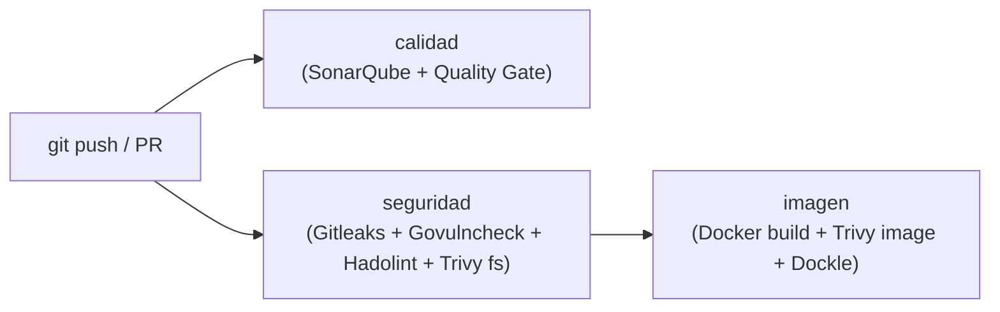

# Microservicio Ejemplo — Tareas (DAS)

Repositorio base del microservicio de gestión de tareas siguiendo los lineamientos técnicos del curso **DAS (Desarrollo de Microservicios)** para el **Hito 0: Entorno y Seguridad**.

### Enlaces de Evidencia (Hito 0)
* **Pipeline de CI (GitHub Actions):** [https://github.com/benbuselola/ejemplo-pingeso/actions](https://github.com/benbuselola/ejemplo-pingeso/actions)
* **Panel de SonarQube:** [http://localhost:9000/dashboard?id=ejemplo-pingeso](http://localhost:9000/dashboard?id=ejemplo-pingeso) (Clave: `ejemplo-pingeso`)

---

## 1. Composición y Estructura del Repositorio

El proyecto implementa una arquitectura desacoplada basada en contratos (**API-First**) y principios de **Clean Architecture** y **Shift-Left Security**.

```text
ejemplo-pingeso/
├── apps/
│   ├── api/                    # Backend en Go
│   │   ├── config/             # Configuración y conexión a base de datos
│   │   ├── controllers/        # Controladores y adaptadores HTTP
│   │   ├── models/             # Entidades y esquemas de datos
│   │   ├── Dockerfile          # Multi-stage build con usuario no-root (nonroot:nonroot)
│   │   ├── go.mod              # Módulos Go (Go 1.26.0 + toolchain go1.26.5)
│   │   ├── go.sum              # Checksums verificados de dependencias
│   │   └── main.go             # Punto de entrada de la API
│   └── web/                    # Frontend SPA (Vue.js / Vite)
│       ├── src/                # Componentes y vistas
│       ├── Dockerfile          # Multi-stage build con nginx-unprivileged (USER 101)
│       ├── nginx.conf          # Configuración Nginx escuchando en puerto 8080
│       ├── package.json        # Dependencias y scripts de frontend
│       └── package-lock.json   # Lockfile de dependencias npm
├── contracts/
│   └── openapi.yaml            # Contrato OpenAPI 3.1 publicado (API-First)
├── docs/
│   └── modos-de-falla.md       # Documentación de resiliencia y modos de falla
├── .github/
│   └── workflows/
│       └── ci.yml              # Pipeline de Integración Continua (calidad, seguridad, imagen)
├── .dockerignore               # Archivos excluidos del contexto Docker (.git, .env*, node_modules)
├── .trivyignore.yaml           # Excepciones autorizadas para Trivy (con CVE y fecha)
├── docker-compose.yaml         # Orquestación de desarrollo local (PostgreSQL, API y Web)
├── sonar-project.properties    # Configuración del escáner SonarQube
└── README.md                   # Documentación general del repositorio
```

---

## 2. Stack Tecnológico y Reglas Obligatorias

| Componente | Tecnología / Versión | Consideraciones del Estándar |
| :--- | :--- | :--- |
| **Backend** | Go `1.26.5` | `go 1.26.0` con `toolchain go1.26.5`. Dependencias críticas actualizadas (`golang.org/x/crypto v0.55.0`, `golang.org/x/text v0.41.0`). |
| **Frontend** | Vue 3 + Vite | Servido mediante Nginx en contenedor no privilegiado. |
| **Base de Datos** | PostgreSQL `17-alpine` | Contenedor aislado por servicio en Compose con healthcheck `pg_isready`. |
| **Contrato** | OpenAPI `3.1.0` | Especificación estricta de rutas, parámetros y códigos de respuesta RFC 9457. |
| **Contenedores** | Docker Multi-Stage | Puertos internos siempre en `8080`. Imágenes ejecutadas con usuarios sin privilegios (`nonroot` / `UID 101`). |

---

## 3. Pipeline de Integración Continua (CI)

El archivo [`.github/workflows/ci.yml`](.github/workflows/ci.yml) implementa las verificaciones automáticas de seguridad y calidad en cada push o pull request:



1. **Job `calidad`**:
   - Valida la integridad del `go.mod` con `go mod verify`.
   - Ejecuta **SonarQube Scan** y evalúa el cumplimiento del **Quality Gate** en código nuevo.
2. **Job `seguridad`**:
   - **Gitleaks**: Detecta secretos, contraseñas y llaves commiteadas accidentalmente.
   - **Govulncheck**: Analiza vulnerabilidades de seguridad alcanzables en el código Go.
   - **Hadolint**: Inspecciona buenas prácticas y sintaxis de Dockerfiles con umbral `error`.
   - **Trivy fs**: Analiza vulnerabilidades en paquetes (`vuln`), malas configuraciones (`misconfig`) y secretos (`secret`).
3. **Job `imagen`**:
   - Compila las imágenes `api:ci` y `web:ci`.
   - **Trivy image**: Analiza las imágenes de contenedor construidas en busca de vulnerabilidades en el runtime.
   - **Dockle**: Audita el cumplimiento de las recomendaciones de seguridad CIS para contenedores Docker.

---

## 4. Guía de Puesta en Marcha: Trivy

**Trivy** es el analizador integral de seguridad para código, dependencias e imágenes de contenedor.

### 4.1. Reglas y Umbrales
* **Tolerancia Cero**: Falla el pipeline (código de salida `1`) ante cualquier vulnerabilidad `HIGH` o `CRITICAL` que disponga de solución (`--ignore-unfixed`).
* **Misconfiguration (`DS-0002`)**: Exige que todo `Dockerfile` declare explícitamente una instrucción `USER` con un usuario distinto a root.
* **Excepciones**: Si una vulnerabilidad no tiene parche o es un falso positivo justificado, se registra en [`.trivyignore.yaml`](.trivyignore.yaml) indicando CVE, justificación técnica y fecha de expiración.

### 4.2. Ejecución Local de Trivy

Puedes ejecutar los mismos análisis de CI en tu máquina usando Docker:

#### A. Escaneo del Sistema de Archivos (`fs`):
```bash
docker run --rm \
  -v /var/run/docker.sock:/var/run/docker.sock \
  -v "$(pwd):/work" \
  -w /work \
  aquasec/trivy:0.76.1 fs \
  --scanners vuln,misconfig,secret \
  --severity HIGH,CRITICAL \
  --ignore-unfixed \
  --exit-code 1 \
  .
```

#### B. Escaneo de Imágenes de Contenedor (`image`):
```bash
# 1. Construir la imagen
docker build -f apps/api/Dockerfile -t api:local .

# 2. Escanear la imagen construida
docker run --rm \
  -v /var/run/docker.sock:/var/run/docker.sock \
  aquasec/trivy:0.76.1 image \
  --severity HIGH,CRITICAL \
  --ignore-unfixed \
  --exit-code 1 \
  api:local
```

---

## 5. Guía de Puesta en Marcha: SonarQube

SonarQube analiza la calidad del código fuente, duplicación, code smells y hotspots de seguridad.

### 5.1. Levantar SonarQube Local

Si aún no está corriendo, levanta una instancia comunitaria en Docker:

```bash
docker run -d --name sonarqube -p 9000:9000 sonarqube:community
```

* **URL de acceso**: `http://localhost:9000`
* **Credenciales por defecto**: Usuario `admin`, Contraseña `admin` (solicitará cambio al primer inicio).

### 5.2. Configuración del Proyecto y Token

1. En la barra superior, pulsa en **Create Project** > **Manually**.
2. Asigna la clave del proyecto (**Project Key**): `ejemplo-pingeso`.
3. Selecciona la opción **GitHub Actions**.
4. En el paso 1 (*Create GitHub Secrets*), pulsa **Generate a token**:
   - Nombre: `github-actions-token`.
   - Copia el token generado (este valor será tu `SONAR_TOKEN`).

### 5.3. Exponer SonarQube a GitHub Actions (Túnel Cloudflare)

> [!IMPORTANT]
> Los ejecutores (*runners*) de GitHub Actions corren en servidores remotos en la nube y **no** pueden conectarse directamente a `http://localhost:9000` de tu equipo. Para habilitar la comunicación durante el pipeline:

Ejecuta en tu terminal el contenedor oficial de **Cloudflare Tunnel** (no requiere registro ni instalación previa):

```bash
docker run --rm -it --network=host cloudflare/cloudflared:latest tunnel --url http://localhost:9000
```

En la salida de la terminal verás una URL pública HTTPS temporal, similar a:
```text
https://xxxx-xxxx-xxxx.trycloudflare.com
```

### 5.4. Configurar Secretos en GitHub

En tu repositorio de GitHub:
1. Ve a **Settings** > **Secrets and variables** > **Actions**.
2. Crea o actualiza los dos siguientes secretos de repositorio (**Repository secrets**):
   - `SONAR_TOKEN`: El token generado en el paso 5.2.
   - `SONAR_HOST_URL`: La URL pública HTTPS generada por el túnel (ej. `https://xxxx-xxxx-xxxx.trycloudflare.com`).

> [!NOTE]
> Mantén la terminal con el comando del túnel de Cloudflare abierta mientras el flujo de GitHub Actions se encuentre en ejecución.

### 5.5. Alternativa: Ejecución Local de SonarScanner

Si deseas disparar el análisis directamente desde tu máquina contra `http://localhost:9000` sin esperar a GitHub Actions:

```bash
docker run --rm \
  --network host \
  -v "$(pwd):/usr/src" \
  sonarsource/sonar-scanner-cli \
  -Dsonar.projectKey=ejemplo-pingeso \
  -Dsonar.host.url="http://localhost:9000" \
  -Dsonar.token="<TU_SONAR_TOKEN>"
```

Una vez completado el escaneo, ingresa a `http://localhost:9000/dashboard?id=ejemplo-pingeso` para revisar el reporte de cobertura y el estado del **Quality Gate**.

---

## 6. Ejecución Local del Entorno de Desarrollo

Para levantar el ecosistema completo (base de datos, backend y frontend) en tu máquina:

```bash
# Construir y levantar contenedores en segundo plano
docker compose up --build -d

# Ver registros en tiempo real
docker compose logs -f
```

* **Frontend**: `http://localhost:3000`
* **Backend API**: `http://localhost:8080`
* **PostgreSQL**: `localhost:5432`

